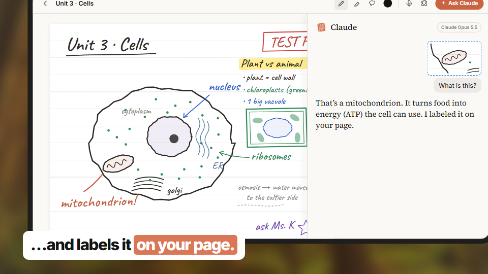
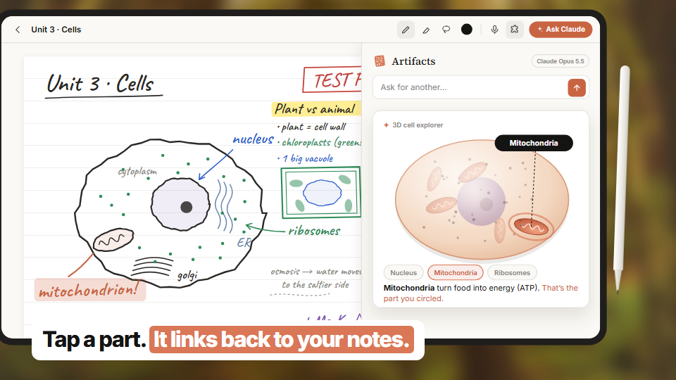

# Claude Study

**Circle any part of your handwritten notes and ask Claude about it, right on the page.**

> A concept and working prototype built on the Claude API. Not affiliated with or endorsed by Anthropic.

**Try it:** [claude-study-concept.vercel.app](https://claude-study-concept.vercel.app) (bring your own Claude API key)



## The problem

Real notes are messy: diagrams, arrows, colors and different-sized writing all on one page. On a tablet, asking an AI
about one part of that page takes six steps. Screenshot it, crop it with your finger, switch apps, paste it, get
asked "which part do you mean?", then describe your own drawing in words.

## What Claude Study does

- **Circle it, ask Claude.** Lasso just the part you mean. Claude sees exactly what you circled, nothing else.
- **Answers stay on your page.** Claude replies in a side panel and marks up your notes in "AI ink": circles, labels,
  check marks and margin notes, drawn where they belong.
- **Artifacts from your notes.** Ask for something you can explore, like a 3D cell, a simulator or a quiz. Claude
  writes a small interactive page from your notes, and it opens right beside them.
- **Your own key, no surprises.** It runs on your Claude API key. Every request shows what it cost, and there's a
  monthly budget meter.



## How it works

1. **Ink is vectors.** Each stroke is `[x, y, pressure][]`, drawn with `perfect-freehand` on a Skia canvas.
2. **Circle → image.** The selected strokes are re-rendered at high resolution (not a screenshot) and sent to Claude
   with your question.
3. **Answers come back as structured output:** `{ reply, annotations }`. Annotation boxes use 0–1000 coordinates on
   the image, mapped back onto the page and drawn as hand-drawn marks.
4. **Artifacts:** Claude writes one self-contained HTML page from your prompt and your notes (typed text, transcribed
   handwriting and a render of the page). It runs in a sandbox (`app/src/lib/toolSandbox.ts`,
   `app/src/components/ToolFrame*`). If it throws an error, "Fix it" sends the error back to Claude.

The request and response contract lives in `server/src/schema.ts` and `app/src/lib/api.ts`; change both together.
In code, artifacts are still called `tools` (`StudyTool`, `ToolsPanel`) because the saved note format uses that name.

```
├── app/      Expo (SDK 58) app for tablet, phone and web: Skia canvas, stylus input, Claude panel, artifacts
├── server/   Node/Express on Vercel: forwards requests to the Claude API with the user's own key
├── video/    Remotion project for the demo video
├── site/     Landing, privacy and account-deletion pages
└── docs/     Notes and README images
```

## Run it locally

```bash
cd server && npm install && npm run dev        # http://localhost:8787
cd app && npm install && npx expo start --web  # http://localhost:8081
```

Point the app at a server with `EXPO_PUBLIC_API_URL` in `app/.env` (see `app/.env.example`). Open
**Settings → Claude key** in the app and paste a key from [console.anthropic.com](https://console.anthropic.com).
The server has no key of its own and never stores yours.

The demo video: `cd video && npm install && npm run studio` (or `npm run render:study`).

## What's real and what's a concept

| Works today | Concept / not yet |
| --- | --- |
| Handwriting, circling, asking Claude, AI ink on the page | Accounts and cloud sync across devices (hidden until the app has its own backend) |
| Artifacts built from your notes, saved with the note | App store releases (Android builds exist for testing) |
| Lecture recording, search, PDF and image import | |
| Bring-your-own-key, per-request costs, budget meter | |

## Name

"Claude Study" follows the "Claude + what it does" naming of Anthropic's products, as a concept pitch. Internal IDs
(`kober` project, `com.kopikocappu.kober`) come from the project's earlier name.
